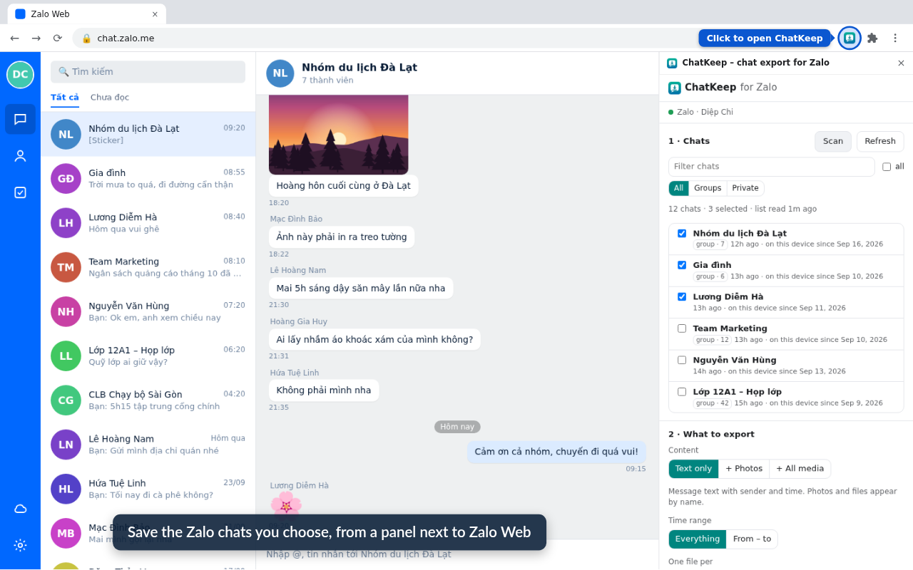
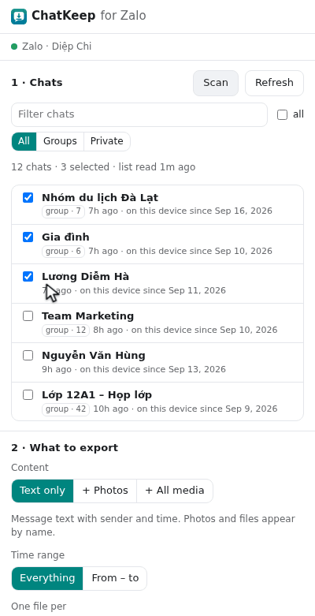
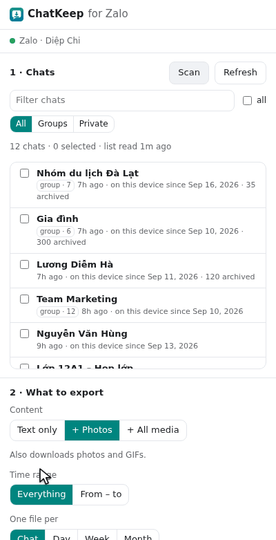
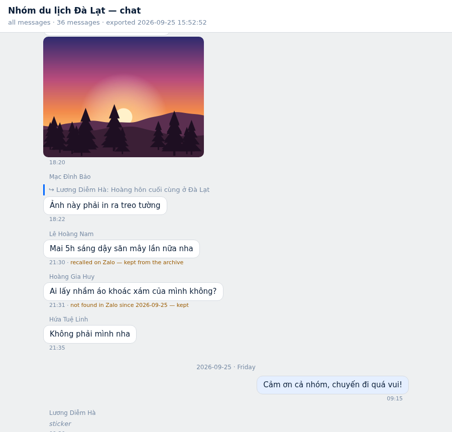

# ChatKeep for Zalo

Save the Zalo chats you choose, from Zalo Web in Chrome, as files on your own computer: **HTML** to
read like a chat, **TXT** to search, **JSON** for other tools. Photos and other media come along if
you want them. Nothing leaves the computer.

[](https://chromewebstore.google.com/detail/adjgghbnnlpabbfienggheffiommblkb)




<sub>Every picture in this repo shows made-up demo chats, not anyone's real messages.</sub>

## What it does

- **Pick chats** from a list (**Scan**, **Refresh**), then export **text only**, **+ photos** or
  **+ all media** (videos, voice messages, files).
- **Three formats**: JSON in the shape of Telegram Desktop's export, HTML to read, TXT in
  WhatsApp's style; one file per chat, day, week or month, or a date range.
- **Resumable and incremental**: Stop and Resume at any time; later runs read only what is new.
  Messages recalled or deleted on Zalo afterwards are **kept** in your files, marked.
- **Quiet**: it reads through Zalo Web's own data layer, so there is no scrolling, no clicking and
  no "seen" receipt.
- Progress in % and a media count such as **12/80**.

Tested on a real account: 47 chats and 7,000+ messages with photos, videos and files.

| Pick and export | Stop and resume | The files |
|---|---|---|
|  |  |  |

## Install

- **Chrome Web Store**: [ChatKeep – chat export for Zalo](https://chromewebstore.google.com/detail/adjgghbnnlpabbfienggheffiommblkb)
- **From source**: `chrome://extensions` → Developer mode → **Load unpacked** → choose `extension/`.

Then open [chat.zalo.me](https://chat.zalo.me/) and click the ChatKeep icon. Chrome 116 or newer.
The full guide with pictures: [docs/userguide/README.md](docs/userguide/README.md).

## How it is built

A Manifest V3 extension with no runtime dependencies: a small **host**, shared **core** services and
one feature **module** (`chats`), the same layout as
[ChatKeep for Messenger](https://github.com/ph4mHoa/chatkeep-messenger), so new features join as
modules behind two small interfaces instead of as new extensions.

| Runs in | Does |
|---|---|
| chat.zalo.me, page world (`bridge.js`) | Finds Zalo Web's data-layer modules and answers read commands over a `postMessage` channel. The only code that touches Zalo's objects |
| chat.zalo.me, isolated world (`content.js`) | Runs the export job: reads through the bridge, normalizes records, keeps the job record so a stopped job resumes where it was |
| Service worker (`worker.js`) | Owns the archive in IndexedDB, downloads media, writes the export files |
| Side panel (`view.js`) | Chat list, options, Start / Stop / Resume, progress |
| Offscreen document | Turns export text into `blob:` URLs, which a service worker cannot do |

More: [ARCHITECTURE.md](docs/ARCHITECTURE.md) · [ZALO.md](docs/ZALO.md) (what Zalo Web looks like
from inside, and what to do when it changes) · [FORMAT.md](docs/FORMAT.md) (the files, and why this
shape) · [TESTING.md](docs/TESTING.md) · [PRIVACY.md](docs/PRIVACY.md).

## Development

```sh
npm install            # once: fake-indexeddb for the tests
npm test               # unit tests and a full job simulation
npm run package        # dist/chatkeep-zalo-<version>.zip, the Chrome Web Store upload
npm run guide-images   # the user guide's pictures, from a scripted demo run with made-up chats
npm run store-assets   # the store's screenshots, promo tile and demo video
```

The guide and store pictures are produced by `scripts/guide/`: the real extension runs in a headless
Chrome for Testing against a stand-in chat.zalo.me with made-up chats, and a drawn pointer clicks
through the panel.

## Privacy

Everything stays in your browser and your Downloads folder. No analytics, no server, no account.
See [docs/PRIVACY.md](docs/PRIVACY.md).

Not affiliated with Zalo or VNG.

## License

[MIT](LICENSE) © 2026 Pham Hoa
