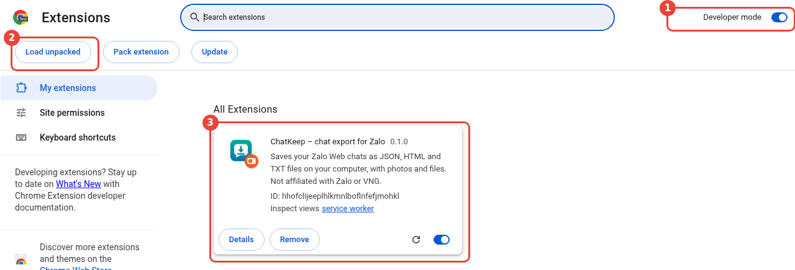
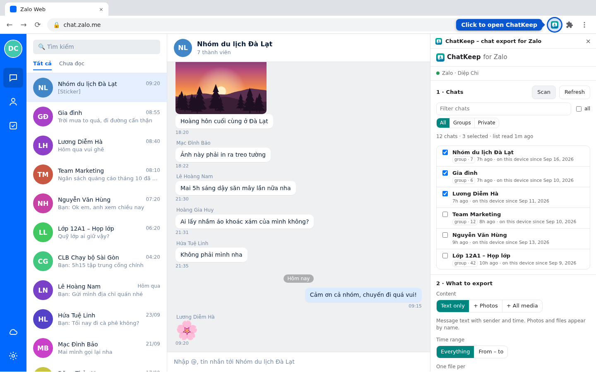
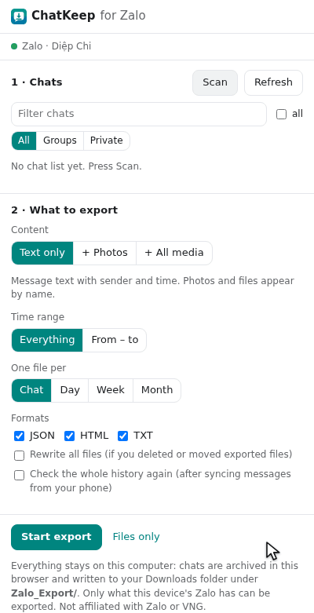
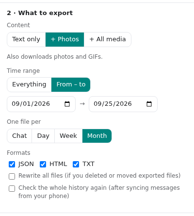
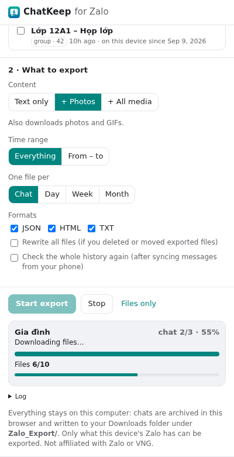
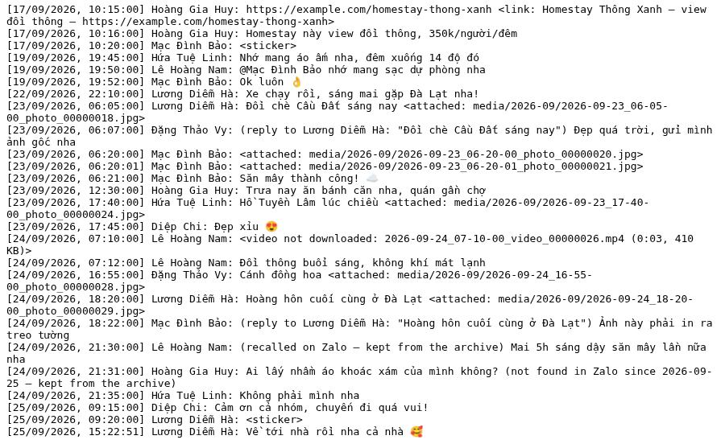

# ChatKeep for Zalo: user guide

ChatKeep saves the Zalo chats you choose, from Zalo Web in Chrome, as files on your computer:
**HTML** to read like a chat, **TXT** to read and search, **JSON** for other tools. It can include
photos, or all media (videos, voice messages, files). You can stop at any time and resume, and
later exports only read what is new. Messages that are recalled or deleted on Zalo later stay in
your files.

Everything stays on your computer. ChatKeep is not made by Zalo or VNG.

The pictures in this guide show made-up demo chats, not anyone's real messages.

## 1. Install

You need Google Chrome 116 or newer. Until ChatKeep is on the Chrome Web Store, install it this
way:

1. Get the `extension` folder of this project (or unzip `chatkeep-zalo-<version>.zip`, made with
   `npm run package`). It is the folder that contains `manifest.json`.
2. Open `chrome://extensions` and turn on **Developer mode** (top right, **1** in the picture).
3. Press **Load unpacked** (**2**) and choose that folder. ChatKeep's card appears (**3**).
4. Pin it: the puzzle-piece icon in the toolbar → the pin next to **ChatKeep – chat export for
   Zalo**.



To update: replace the folder's files, then press the reload arrow on ChatKeep's card in
`chrome://extensions`. The Zalo tab does not need a reload.

## 2. Open it

1. Open [chat.zalo.me](https://chat.zalo.me/) and log in as usual (scan the QR code with your
   phone).
2. Click the ChatKeep icon. A side panel opens next to Zalo.
3. The line at the top shows whether ChatKeep can work: **Zalo · your name** (green) means ready.
   If there is no Zalo tab, the **Open Zalo** button opens one.



## 3. Your first export

1. Press **Scan**. The list shows every chat Zalo Web has, newest activity first: its name, *group ·
   members* for groups, the last activity, **on this device since** (where this computer's history
   of the chat starts) and, after an export, how many messages are archived. Chats hidden with a
   PIN are not listed.
2. Tick the chats you want. The filter box, **All / Groups / Private**, and **all** (ticks every
   chat shown) help with long lists.

   

3. Choose what to export (section 2 of the panel, [below](#4-the-options)).
4. Press **Start export**.
5. When the panel says **Finished. Files are in Downloads/Zalo_Export/.**, open that folder.

   

How long it takes: on the test account, 47 chats with about 7 300 messages took 34 seconds as text
only; 28 photos took 11 seconds. Videos and large files take as long as their download.

**Refresh** reads the chat list again quickly (new chats, names, latest activity); **Scan** also
finds where each chat's history on this computer starts. Both keep your selection.

## 4. The options



| Option | Choices |
|---|---|
| **Content** | **Text only**: every message with sender and time; photos and files appear by name. **+ Photos**: also downloads photos and GIFs. **+ All media**: also downloads videos, voice messages and files (large chats can take a while and a lot of disk space) |
| **Time range** | **Everything**, or **From – to** (whole days). A range is written to a folder of its own (`range_2026-09-15_to_2026-09-20`) and never replaces the full files |
| **One file per** | **Chat**, **Day**, **Week** (Monday to Sunday) or **Month** |
| **Formats** | **JSON**, **HTML**, **TXT**; any combination |
| **Rewrite all files** | Normally a file that has not changed is not written again. Tick this if you deleted or moved exported files |
| **Check the whole history again** | Reads every message of the chat again instead of only the new ones. Use it once after syncing messages from your phone ([section 9](#9-how-far-back)) |

**Files only** writes the files again from what is already archived, without reading Zalo: for
example to get another format or another split. ChatKeep remembers your options and your selection.

## 5. Progress

- The first line: the chat being exported and **chat 3/12 · 41%** for the whole export.
- The second line says what is happening: *Reading · 1,200 messages (1,200 new) · back to 10 Sept
  2026 · 60%*, *Asking Zalo's server for older messages*, *Looking up names…*, *Downloading
  files…*, *Writing files…*.
- With photos or media: **Files 12/80**, with *2 failed* or *30 saved earlier* when that applies.
- **Log** opens a list of what was done, chat by chat.



## 6. Stop and resume

- **Stop** stops after the current step. Everything read or downloaded so far is kept.
- **Resume** continues where it stopped. Nothing already saved is read or downloaded again.
- Closing the side panel does not stop an export: it runs in the Zalo tab. Open the panel again to
  watch it.
- If the Zalo tab reloads, the export continues by itself.
- If you close the Zalo tab or Chrome, the export pauses. Open Zalo again, open the panel, press
  **Resume**.


## 7. Later exports only read what is new

ChatKeep keeps an archive of every message it has exported, inside Chrome. Each export remembers
which stretches of each chat it read completely, so the next one reads only the messages that came
after it (plus a few older ones, to check nothing changed) and any older history that has appeared
since. Files that did not change are not written again; photos and files already saved are not
downloaded again; a download that failed is tried again next time (up to three times).

So exporting the same chats every day or every week is quick.

## 8. Recalled, deleted and edited messages are kept

| On Zalo | In your files |
|---|---|
| A message is recalled (*thu hồi*) | It stays, marked *recalled on Zalo — kept from the archive* |
| A message is gone (deleted, or no longer on this computer) | It stays, marked *not found in Zalo since 2026-10-02 — kept from the archive* |
| A message is edited | The new text, marked *edited*; the HTML shows the earlier versions, the JSON keeps them in `edit_history` |

A later export never removes anything from your archive or your files.


## 9. How far back

ChatKeep exports **what Zalo Web has on this computer**: the messages this browser received since
you logged in on it, plus what Zalo has loaded. The list's *on this device since* shows where each
chat starts. For every chat, ChatKeep also asks Zalo's server once for older messages; sometimes
Zalo has some.

To get older history onto this computer, use Zalo's own sync from your phone: in Zalo Web,
**⚙ → Settings → Sync messages → Sync now** (*⚙ → Cài đặt → Đồng bộ tin nhắn → Đồng bộ ngay*), and
confirm on your phone. Zalo describes it as syncing *text* messages. Then press **Scan** and export
again with **Check the whole history again** ticked once.

Zalo's own backup (to Zalo's servers and Google Drive) only restores into Zalo; no tool can read it.

## 10. Your files

```
Downloads/Zalo_Export/
  Chat_name_<chat id>/
    Chat_name.html  .txt  .json      one file per chat, or 2026-09.json, 2026-W39.json, 2026-09-24.json …
    index.html                       when the HTML has more than one page (1 000 messages per page)
    media/2026-09/…                  photos and files, when included
    range_2026-09-15_to_2026-09-20/  a date-range export
```

- **HTML**: open it in Chrome. Bubbles like Zalo, a line per day, replies, photos and videos inline.
- **TXT**: one line per message, `[24/09/2026, 12:41:10] Name: text`, like WhatsApp's export.

  

- **JSON**: in the shape of Telegram Desktop's export, which many tools read; Zalo's extra details
  are under `zalo`.
- Names have no spaces or brackets (they become `_`). A chat's folder keeps its first name if the
  group is renamed.
- Photos are saved as JPEG. The rare photo that Zalo has only as JPEG XL is saved as `.jxl`; Chrome
  cannot show it, other image viewers can.

The full description is in [../FORMAT.md](../FORMAT.md).

## 11. Privacy

ChatKeep has no server and sends nothing anywhere. Your messages are kept in Chrome (for the next
export) and written to your Downloads folder. To delete the archive, remove the extension in
`chrome://extensions`; delete exported files as you would any file. It does not open chats, mark
messages as seen, or send anything in your name. Details: [../PRIVACY.md](../PRIVACY.md).

## 12. Limits

- Only what Zalo Web has on this computer ([section 9](#9-how-far-back)). Zalo PC, the desktop app,
  keeps its own history, which ChatKeep cannot read.
- Chats hidden with a PIN are not listed.
- Reactions are not exported. Stickers are noted, not downloaded. Polls and Zalo's cards keep their
  title or text only.
- Voice messages, locations and calls are handled but were not on the test account, so they are
  untested.
- Zalo Web runs in one tab at a time, so ChatKeep works in the tab you have open.
- When Zalo updates Zalo Web, ChatKeep can stop working until it is updated too (the panel then
  says *Zalo has changed*). Your archive and files are not affected.
- Zalo's terms of use forbid software that Zalo has not approved. ChatKeep only reads your own
  chats in your own Zalo tab, but Zalo has not approved it; use it at your own judgment.
- The panel is in English.

## 13. When something goes wrong

| The panel says | What to do |
|---|---|
| *No Zalo tab. Open Zalo and log in.* | Press **Open Zalo**, or open chat.zalo.me yourself |
| *Zalo is loading… (log in, or reload the tab if this stays)* | Log in; if it stays, reload the Zalo tab |
| *Zalo is active in another tab…* | Zalo works in one tab: close the other Zalo tab, or press **Kích hoạt** in this one, then **Resume** |
| *Zalo has changed: parts not found (…)* | Zalo updated its web app; ChatKeep needs an update. Nothing is lost |
| *Stopped: …* | The reason follows; fix it and press **Resume** |
| *Finished with 2 error(s) — see the log* | Open **Log**; the other chats were exported |
| *Files 70/80 · 10 failed* | Run the export again later; each file is tried up to three times. Missing ones are noted in the files as *photo download failed* |
| *Select chats that have been exported at least once.* | **Files only** works from the archive, so export those chats first |
| A chat exports 0 messages | It has no history on this computer ([section 9](#9-how-far-back)) |
| You deleted exported files | Tick **Rewrite all files** and press **Files only** |

## 14. Questions

**Can I keep using Zalo while it exports?** Yes, in the same tab. Do not open Zalo in a second tab.

**Does it open my chats or mark messages as seen?** No. It reads through Zalo Web's own data, not
the screen.

**Does it work with Zalo PC or the phone app?** No, only with Zalo Web (chat.zalo.me) in Chrome.

**Where is the archive, and can I move it?** Inside Chrome, in ChatKeep's storage. It cannot be
moved yet; the exported files are the portable copy.

**Can I export someone else's account?** Only the account logged in to Zalo Web in that Chrome.
